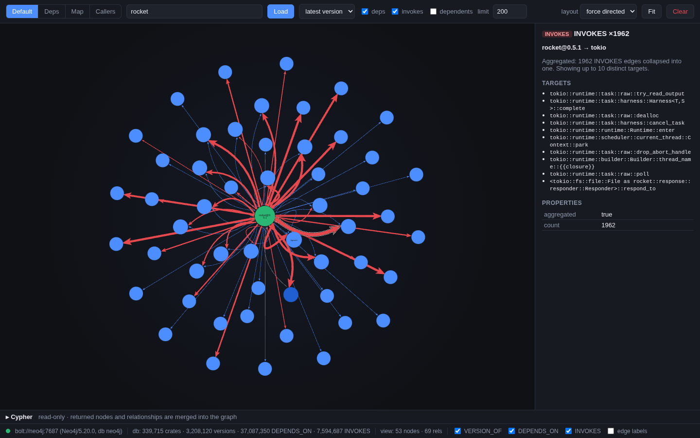
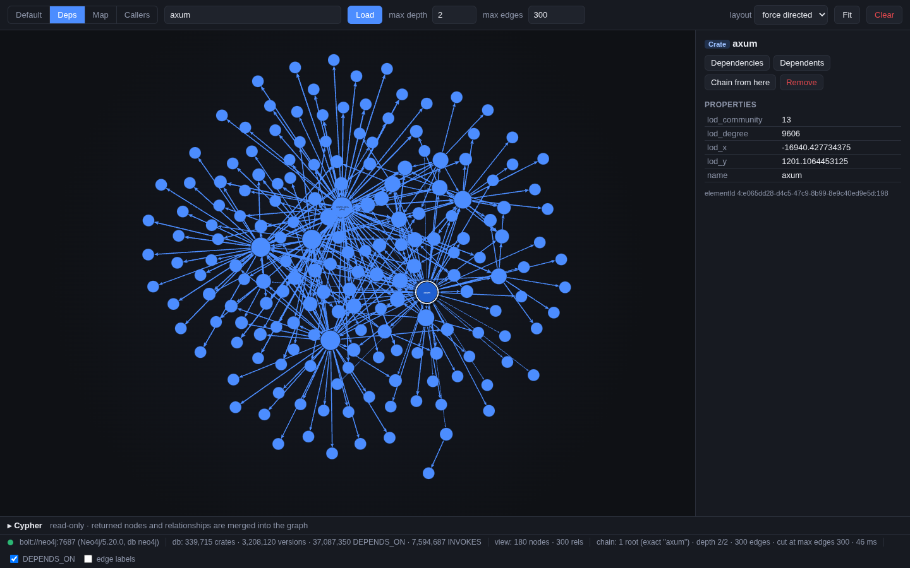
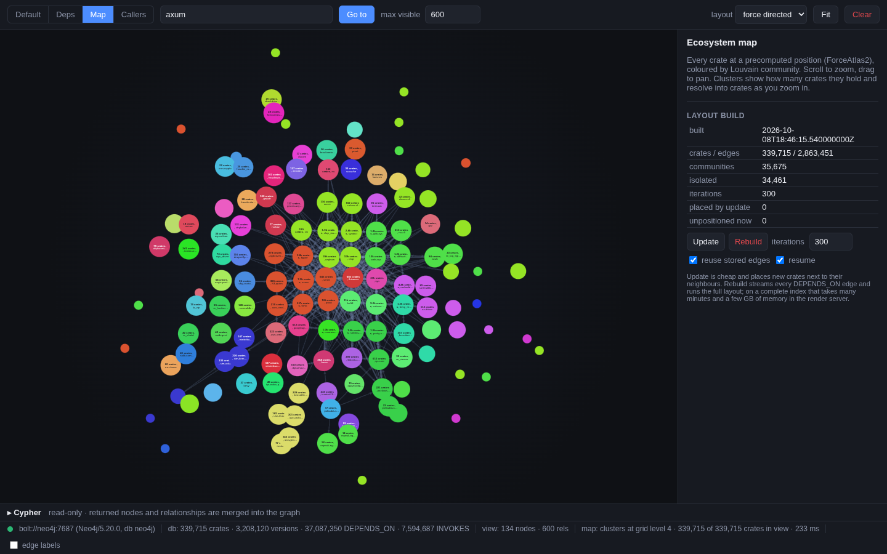
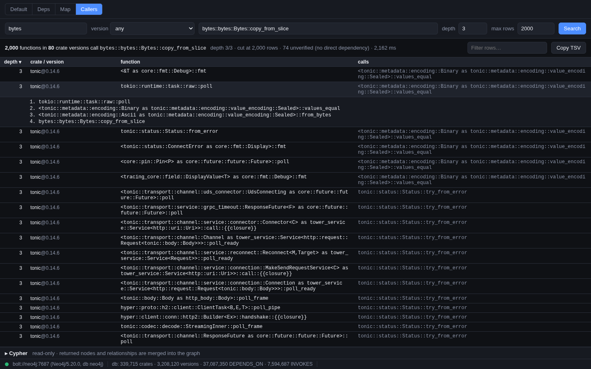

# Painter

Painter builds a Neo4j graph of dependencies and function calls between all crates on crates.io.

The graph can be explored with the web UI in `render/` ([render/README.md](render/README.md)).

**Default**: a crate's latest version with its dependencies and calls (the UI aggregates calls
into `INVOKES` edges).



**Deps**: the transitive dependency chain (`axum`, two levels).



**Map**: every crate on a precomputed layout, coloured by community.



**Callers**: transitive callers of a function (`bytes::bytes::Bytes::copy_from_slice`).



## Pipeline

1. **Index import**: every version of every crate in the crates.io index becomes
   `Crate` / `Version` nodes with `VERSION_OF` and `DEPENDS_ON` edges.
2. **Compile**: `cargo +<toolchain> rustc --release --lib -- -g --emit=llvm-bc -C lto=off --cap-lints=warn`
   per crate, with default features.
3. **Export**: parse each crate's bitcode, demangle, drop std/core/alloc/runtime callees, and write
   the call graph. The callee crate is the first path segment of the demangled symbol.
4. **Metadata**: `generate-metadata` reads each `.crate` and adds unsafe, build-script, native-code,
   diff, and crates.io registry facts to the graph.

## Schema

- `(Crate { name })`
- `(Version { name, version, semver_*, latest? })` plus the `generate-metadata` properties
  (listed in [docker/queries.md](docker/queries.md))
- `(Crate)-[:VERSION_OF]->(Version)`: crate to version
- `(Version)-[:DEPENDS_ON { requirement, features, kind, optional }]->(Crate)`
- `(Version)-[:HAS_FN]->(Fn)-[:IS]->(Symbol { name })`: a function of the version (the caller)
- `(Fn)-[:CALLS { copies }]->(Symbol { name })-[:IN]->(Crate)`: a function it calls, in the crate
  its path names

One `Fn` per (version, calling function), one `CALLS` per distinct call, one `Symbol` per demangled
name shared by every version. `copies` counts the compiled (caller, callee) pairs behind a call,
because monomorphised generics demangle to the same name. Re-exporting a version replaces its `Fn`s.

## Limitations

- Only crates that build locally are imported (path dependencies, exotic build scripts fail).
- The callee's version is not resolved.
- Calls are lost to inlining (release mode; LTO is off but the optimizer still runs), dynamic dispatch,
  and generics that are never instantiated in the crate itself.

# Quick Start

## Requirements
- Rust stable or nightly to build painter.
- LLVM 22 with development headers. The `llvm-22` feature of `llvm-ir-analysis` in `Cargo.toml`
  must match the installed major version; `llvm-sys` finds `llvm-config` on `PATH` or under
  `LLVM_SYS_221_PREFIX`.
- A second toolchain with the `cargo` component for `--toolchain` (default `1.67`). Its LLVM must not
  be newer than 22: Rust 1.96 works, 1.99 (LLVM 23) does not.
- A clone of [crates.io-index](https://github.com/rust-lang/crates.io-index) in `PAINTER_INDEX_PATH`
  (without it painter clones the full index under `~/.cargo`).
- The `.crate` files, flat (`serde-1.0.0.crate`) or sharded like the index
  (`se/rd/serde/serde-1.0.0.crate`), e.g. from
  [crates-spider](https://github.com/walterhpearce/crates-spider.git).
- Docker, for Neo4j and the graph UI.

## Build
```
git clone --recurse-submodules https://github.com/rustfoundation/painter
cd painter
cargo build --release
rustup toolchain install 1.96.1
```
`llvm-ir` and `llvm-ir-analysis` are submodules (`git submodule update --init` in an existing
clone). See [BUILDING.md](BUILDING.md) for installing LLVM.

## Neo4j and the UI
```
docker compose up -d
```
Neo4j is on http://localhost:7474 (`neo4j` / `changeme123`, set in `docker-compose.yaml`), the graph UI
on http://localhost:8080 ([render/README.md](render/README.md)).

Before the first import, create the constraints and indexes at the top of
[docker/queries.md](docker/queries.md). The import relies on the `Crate.name` uniqueness constraint
to avoid duplicates under concurrency.

## Run
Every command takes `-d bolt://127.0.0.1:7687 -u neo4j -p changeme123` for the database and
`-s sources -c crates -b bytecodes` for the roots (`-c` holds the `.crate` files; `-s`, `-b` are
outputs). `RUST_LOG=info` shows progress. Commands are shown as the built `painter` binary
(`cargo run --release -- <command>`).
```
export PAINTER_INDEX_PATH=/path/to/crates.io-index
painter create-fresh-db
painter set-latest-versions
painter compile-all --toolchain 1.96.1
painter export-all-neo4j
painter generate-metadata
```
- `create-fresh-db` skips existing versions, so it can be restarted; `import-crates <CRATE>...`
  refreshes named crates. Re-run `set-latest-versions` after importing new versions.
- `compile-all` builds only the highest version of each crate unless `--all-versions` is given;
  `--only`, `--top-downloads`, `--top-reverse-deps`, `--top-maintainers`, and `--newer-than` narrow
  it (the `--top-*`/`--newer-than` rules query [ecosyste.ms](https://packages.ecosyste.ms)).
  `plan` prints the selection; `compile-check` reports what is compiled and exported.
  Versions that already have a directory under `-b` are skipped; delete it to rebuild.
- `generate-metadata` is resumable (jobs mark the versions they wrote; `--rescan` redoes) and can
  run next to `compile-all`. `--job` selects jobs, see `--help`.

## Querying
Neo4j browser, `cypher-shell`, or the UI's Cypher panel; more in [docker/queries.md](docker/queries.md).
```
// Crates that depend on serde in any version
MATCH (c:Crate)-[:VERSION_OF]->(:Version)-[:DEPENDS_ON]->(:Crate {name: 'serde'})
RETURN count(DISTINCT c) AS dependents

// Crates a version calls into, by number of distinct calls
MATCH (:Version {name: 'rocket', version: '0.5.1'})-[:HAS_FN]->(:Fn)-[:CALLS]->(:Symbol)-[:IN]->(t:Crate)
RETURN t.name AS crate, count(*) AS calls ORDER BY calls DESC
```
Reach a crate's versions through its `Crate` node: `(:Version {name: ...})` without a version cannot
use the `(name, version)` index and scans every version.

## CI
`lint`, `build`, and `test` workflows run on push to `main` and on pull requests. The compile tests
need Rust 1.96.1 because its LLVM matches the one `llvm-ir` links against.

## Contributing and license

See [CONTRIBUTING.md](CONTRIBUTING.md) and the [Code of Conduct](CODE_OF_CONDUCT.md).

MIT OR Apache-2.0, documentation under CC-BY-4.0: [LICENSE-APACHE](LICENSE-APACHE),
[LICENSE-MIT](LICENSE-MIT), [LICENSE-documentation](LICENSE-documentation), [COPYRIGHT](COPYRIGHT).
